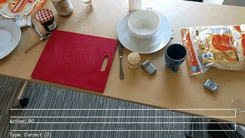
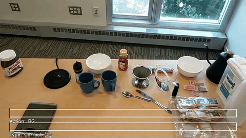
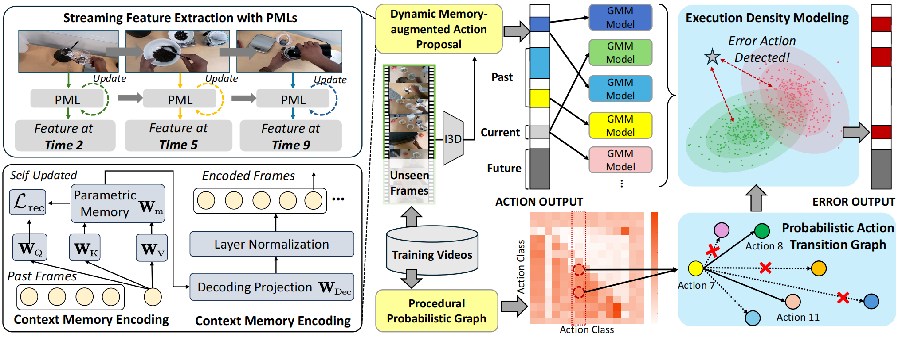
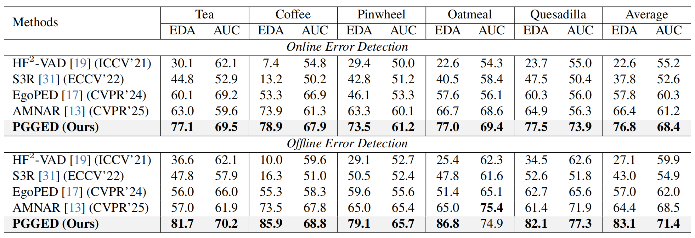
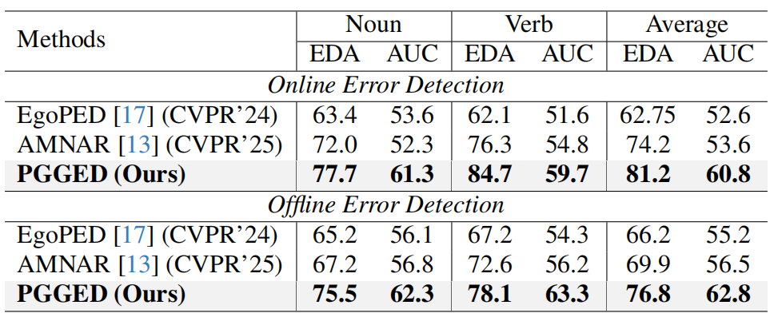
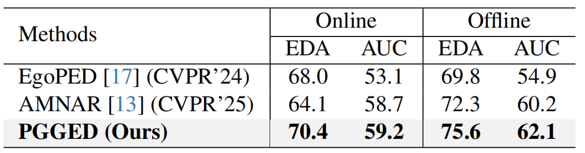
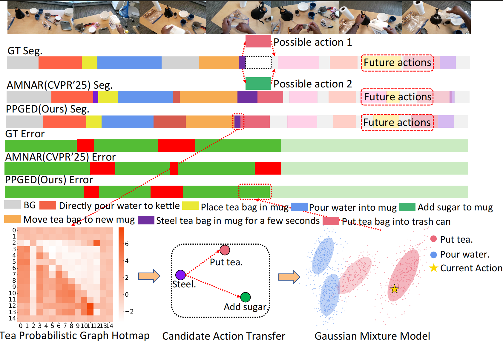

# Online Error Detection with Procedural Probabilistic Graph in Egocentric Video Stream

---
## Visualization



## Introduce
We propose a novel ***P**rocedural **P**robabilistic
**G**raph **E**rror **D**etector* (PPGED) for egocentric error detection. It tackles these challenges through a dynamic memory-augmented action proposal for video streaming and constructs explicit probabilistic procedural constraints to capture the complexity among procedural sequences. Specifically, our PPGED method consists of two key components: (1) The Dynamic Memory-augmented Action Proposal module that harnesses a parametric memory to dynamically compress historical context and extract discriminative action features from streaming video. (2) The Procedural Probabilistic Graph module that combines an action transition graph to probabilistically model valid action sequences and execution distributions.



## Experiments

This codebase has been developed and validated under the following environment:

- Ubuntu 20.04.5 LTS
- Python: 3.8
- PyTorch: 1.13.1
- CUDA: 11.7
- GPU: 48GB NVIDIA A6000

### Dataset

Download Data: [EgoPER](https://github.com/robert80203/EgoPER_official), [HoloAssist](https://holoassist.github.io), [Captaincook4D](https://github.com/CaptainCook4D)

### Trainling

For EgoPER:

```
python train.py ./config/EgoPER_online_both_final/coffee_aod_b1_n2_smooth_causal_gmm_pcml.yaml --output final
```

For HoloAssist:

```
python train.py ./config/HoloAssist/holo_bgr1.0_verb_b1_n1.yaml --output final
```

For CaptainCook4D:

```
python train.py configs/CaptainCook4d/cook4d_b1_n1.yaml --output final
```

### Inference

For EgoPER:

```
python test.py ./configs/EgoPER_online_both_final/coffee_aod_b1_n2_smooth_causal_gmm.yaml ./ckpt/EgoPER/coffee_aod_b1_n2_smooth_causal_gmm_final

python metric_vis_egoper.py --task coffee --dirname coffee_aod_b1_n2_smooth_causal_gmm_final/ --dirs EgoPER -as

python test_ed.py ./configs/EgoPER/coffee_aod_b1_n2_smooth_causal_gmm.yaml ./ckpt/EgoPER/coffee_aod_b1_n2_smooth_causal_gmm_final

python metric_vis_egoper.py --task coffee --dirname coffee_aod_b1_n2_smooth_causal_gmm_final/ --dirs EgoPER -ed
```

For HoloAssist:

```
python test_ed.py ./configs/HoloAssist/holo_bgr1.0_verb_b1_n1.yaml ./ckpt/HoloAssist_taskgraph/holo_bgr1.0_verb_b1_n1 >> log/holoverb/test_ed.log

python metric_vis_holo.py  --dirname holo_bgr1.0_verb_b1_n1/ -ed --action verb --dirs HoloAssist_taskgraph >> log/holoverb/metric.log
```

For CaptainCook4D:

```
python test_ed.py ./configs/CaptainCook4d/cook4d_b2_n1.yaml ./ckpt/CaptainCook4D/cook4d_b2_n1_final >> log/captaincook4d/test.log

python metric_vis_cook4d.py  --dirname cook4d_b2_n1_final/ -ed --dirs CaptainCook4D >> log/captaincook4d/metric.log
```

## Result

**EgoPER:**



**HoloAssist:**



**CaptainCook4D:**



## Qualitative Analysis
